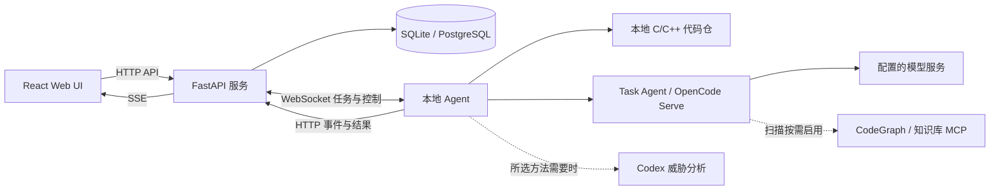

# 架构与数据存储

[文档目录](README.md) · [框架开发指南](framework_development.md)

## 组件职责



- **服务端**：账户与权限、扫描配置、Agent 管理、规则元数据和下载包、结果持久化、页面实时事件。
- **本地 Agent**：接收任务、准备扫描目录、构建静态索引、协调威胁分析和漏洞挖掘、执行复核与验证、上报结果。
- **Task Agent**：提供统一的 `run_opencode_task()`，管理 OpenCode Serve、模型池、队列、Session、重试和 Token 用量；也可独立使用。
- **分析方法和引擎**：通过目录清单发现，负责业务分析与产物。Codex 威胁分析方法使用 Codex SDK，不能将它等同于 OpenCode 模型池任务。

标准扫描先为静态分析准备索引，再并行启动威胁分析与不依赖威胁产物的漏洞挖掘。攻击模式审计等待威胁分析成功后启动；确认问题按配置进入独立的复核和验证队列。完整依赖图见[框架扫描流程](framework_development.md#2-整体扫描流程)。

## 源码与结果的数据边界

Agent 扫描不要求向 Web 服务上传整个代码仓，但模型需要通过文件工具或 MCP 获取审计上下文。使用远端 Provider 时，相关上下文可能发送给模型服务；启用远端 MCP 时，还应按对应服务的行为理解数据流。

服务端保存候选点、文件清单、威胁分析产物、漏洞结论、复核证据和验证结果。漏洞模型包含 `vulnerable_code`、`function_source` 等字段，报告和阶段输出也可能含代码片段，不能承诺服务端只接收不含源码的结论。

权威审计结果通过 Agent 本地 outbox 补传，收到后端确认后删除待发项；普通日志和进度为尽力上报。WebSocket 重连会恢复仍活跃的任务身份，续扫依据服务端检查点和 Agent 产物执行。协议与多 Worker 协调细节见[生产部署](production_scaling.md)。

## 两种代码图谱

| 能力 | 用途 | 启用条件 |
| --- | --- | --- |
| `code_index.db` | Ctags/tree-sitter 构建的本地 SQLite 索引，供静态规则读取函数、结构体和调用关系 | 本轮运行 `static_candidate` 或 `multi_version` 的静态分析时构建或复用 |
| CodeGraph MCP | 向模型提供可选代码查询工具 | 创建扫描时显式启用，本地 CLI 或远端 MCP |

关闭 CodeGraph MCP 不会关闭静态规则需要的 `code_index.db`。仓库的 `mcp_server/` 是独立源码查询实现，未启用 MCP 的扫描不会自动回退到它。

## 数据存储

### Agent 机器

| 位置 | 内容与生命周期 |
| --- | --- |
| `<code_scan_path>/code_index.db` | 静态索引；按扫描范围构建或复用，删除后需要重新构建 |
| `~/.opendeephole/scans/<scan_id>/` | 扫描产物、`candidates.json`、规则包、威胁分析与多版本检查点；当前扫描收尾不统一删除该目录 |
| `~/.opendeephole/fp_reviews/<review_id>/<vuln_index>/` | 单项复核工作目录；当前复核收尾不统一删除该目录 |
| `~/.opendeephole/vulnerability_validation/` | 验证工作目录及产物 |
| `~/.opendeephole/report_outbox.sqlite3` | 尚未获得后端确认的权威报告；确认后清除相应行 |
| `~/.opendeephole/opencode_workspace/` | Agent 的受管 OpenCode 配置、Skill 与 Hook |
| `$CODEX_HOME` 或 `~/.codex/` | Codex 用户配置及 OpenDeepHole 托管区，见[配置参考](configuration.md#codex-运行配置) |

索引只覆盖本次 `code_scan_path`。扫描子目录不会读取或删除项目根目录遗留的索引。扫描目录及复核目录会保留用于恢复与证据查询，需要按实际任务状态管理保留周期。

### 服务端

| 配置或位置 | 内容 |
| --- | --- |
| `storage.scans_dir`，默认 `../OpenDeepHoleData/scans/` | 扫描文件、兼容数据；SQLite 模式使用其中的 `scans.db` |
| `storage.projects_dir`，默认 `../OpenDeepHoleData/projects/` | 项目存储目录；Agent 扫描直接使用本机路径，不依赖向该目录上传仓库 |
| `storage.user_skills_dir`，默认仓库上层 `OpenDeepHoleData/user_skills/` | Web 创建的用户规则与 Skill |
| `storage.database_url` / `OPENDEEPHOLE_DATABASE_URL` | 非空 PostgreSQL 连接串选择数据库存储，数据库之外的文件仍需保留 |
| `logs/opendeephole.log` | 服务端日志，仓库配置为 DEBUG、10 MiB 轮转、5 份备份 |

显式填写的相对存储路径按 `config.yaml` 所在目录解析。迁移数据库和清理历史数据前阅读[存储迁移](database-storage-migration.md)。

## 项目结构

```text
OpenDeepHole/
├── backend/             # FastAPI API、存储、Agent 通信、SSE
├── frontend/            # React / TypeScript / Vite / Tailwind CSS
├── deephole_client/     # Agent 与业务分析过程
│   ├── code_graph_build/
│   ├── threat_analysis/methods/
│   ├── vulnerability_mining/engines/
│   ├── fp_review/methods/
│   └── vulnerability_validation/product_validators/
├── task_agent/          # OpenCode 模型任务和 Serve 管理
├── codex_sdk/           # Codex SDK 适配
├── mcp_server/          # 独立源码查询 MCP
├── docs/                # 使用、开发和运维文档
├── tools/               # Checker 自测、外部平台调用工具
├── scripts/             # 数据迁移、基准和测试辅助脚本
├── tests/               # 后端、Agent、组件和规则测试
├── config.yaml          # 服务端配置
├── agent.yaml           # Agent 启动与受管配置模板
├── requirements.txt
├── requirements-agent.txt
├── run_agent.sh / .bat
├── start.sh
├── Dockerfile
└── docker-compose.yml
```

更细的入口与返回契约以[框架开发指南](framework_development.md)和各组件 README 为准。
